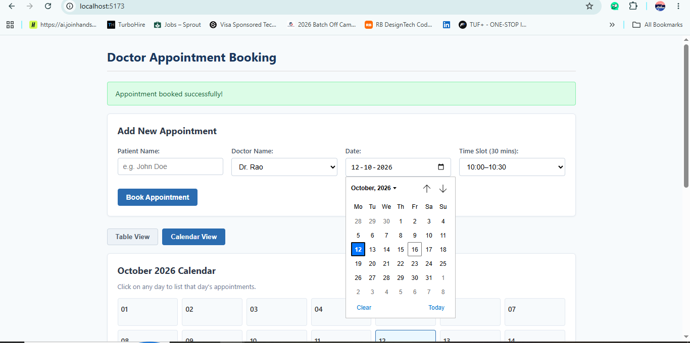
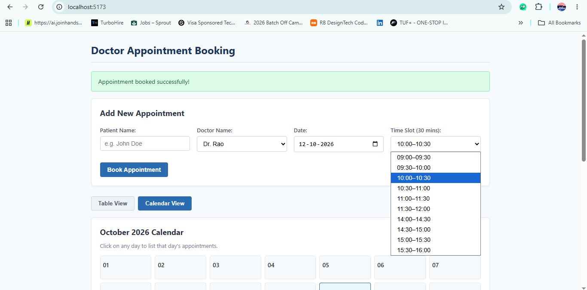
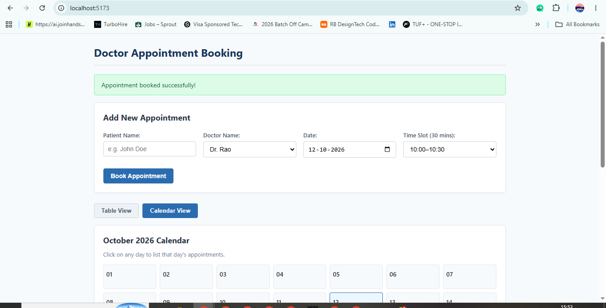
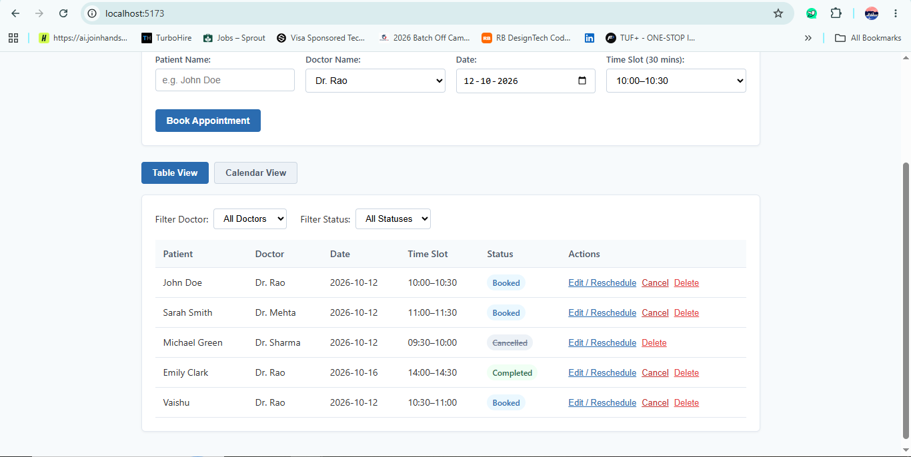
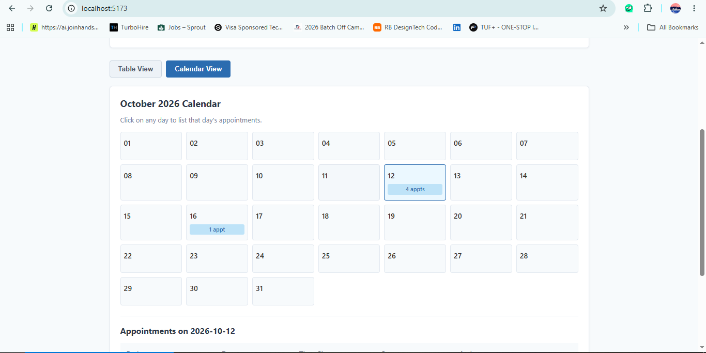

# Doctor Appointment Booking App

A simple full-stack appointment booking application built with React on the frontend and Java (Spring Boot) on the backend. It lets users schedule, view, reschedule, filter, and cancel 30-minute doctor consultations with automatic double-booking conflict prevention.

---

## 🌐 Live Demo & Deployment

- **Live Cloud App**: **[https://doctor-appointment-jbkl.onrender.com/](https://doctor-appointment-jbkl.onrender.com/)** *(Hosted on Render)*

---

## Tech Stack

- **Frontend**: React 19, Vite, Plain CSS
- **Backend**: Java 17, Spring Boot 3.3.4 (Spring Web, In-Memory Thread-Safe Storage)
- **Architecture**: SOLID Principles (Controller-Service-Repository pattern)

---

## Features & Walkthrough

### 1. Appointment Booking
Users can schedule an appointment by providing the patient name, selecting a doctor, choosing a date, and selecting an available 30-minute consultation slot.



#### 30-Minute Time Slot Intervals
Appointments are organized into standard 30-minute slots:



#### Booking Confirmation
Once submitted, the appointment is created and a confirmation banner is displayed:



---

### 2. Table View & Live Filtering
The main table displays all appointments with patient details, doctor name, date, time slot, and status badge.



- **Doctor Filter**: Filter by specific doctor (`Dr. Rao`, `Dr. Mehta`, `Dr. Sharma`) or view `All Doctors`.
- **Status Filter**: Filter by `Booked`, `Completed`, or `Cancelled`.
- **Edit / Reschedule**: Loads the record into the form to adjust date, time slot, or doctor.
- **Cancel**: Quickly marks an appointment as `Cancelled` (which immediately frees the slot).
- **Delete**: Permanently removes an appointment with confirmation.

---

### 3. Interactive Calendar View
Switching to the **Calendar View** renders an interactive monthly calendar (October 2026).



- **Day Badges**: Each calendar day displays the total number of scheduled appointments (e.g., `4 appts` on 12 Oct, `1 appt` on 16 Oct).
- **Day Inspection**: Clicking any date displays a detailed list of all appointments scheduled on that specific day directly below the calendar.

---

### 4. Double-Booking Conflict Prevention (409 Conflict)
The backend enforces that **the same doctor cannot be booked twice for the same date and time slot**.

- **Backend Enforcement**: Evaluated in `AppointmentService.java` during both booking and rescheduling.
- **409 Conflict Response**: If a collision occurs, the API rejects the request with HTTP 409:
  ```json
  {
    "message": "Dr. Rao is already booked at 10:00 on 12 Oct"
  }
  ```
- **UI Error Display**: The frontend displays a clear red alert message with the exact conflict reason.
- **Slot Liberation**: Cancelled appointments do not block slots, so previously cancelled times can be booked again immediately.

---

## Test Cases & Verification

| Test Scenario | Input Data | Expected Result | Verified Status |
| :--- | :--- | :--- | :--- |
| **1. Double Booking Conflict** | Dr. Rao, 12 Oct, 10:00–10:30 | Rejected: `"Dr. Rao is already booked at 10:00 on 12 Oct"` (HTTP 409) | Passed |
| **2. Different Doctor, Same Slot** | Dr. Mehta, 12 Oct, 10:00–10:30 | Allowed (independent schedule) | Passed |
| **3. Same Doctor, Different Slot** | Dr. Rao, 12 Oct, 10:30–11:00 | Allowed (next slot is free) | Passed |
| **4. Re-booking Cancelled Slot** | Dr. Rao, 12 Oct, 10:00–10:30 after cancellation | Allowed (cancelled slots are freed) | Passed |
| **5. Rescheduling Conflict** | Reschedule appointment to an already booked slot | Rejected with HTTP 409 Conflict | Passed |

---

## Project Structure & SOLID Principles

```text
Doctor_Appointment/
│
├── backend/
│   ├── build.gradle                              # Gradle build configuration
│   ├── settings.gradle                           # Project name: 'doctor-appointment'
│   ├── gradlew / gradlew.bat                     # Gradle wrapper scripts
│   └── src/main/
│       ├── java/com/doctorappointment/
│       │   ├── DoctorAppointmentApplication.java # Spring Boot entry point
│       │   ├── model/
│       │   │   └── Appointment.java              # Single Responsibility: Entity model
│       │   ├── repository/
│       │   │   └── AppointmentRepository.java    # Single Responsibility: Data access & persistence
│       │   ├── service/
│       │   │   └── AppointmentService.java       # Single Responsibility: Conflict logic & business rules
│       │   └── controller/
│       │       └── AppointmentController.java    # Single Responsibility: HTTP REST endpoints
│       └── resources/
│           └── application.properties            # Server port 8080 configuration
│
├── frontend/
│   ├── package.json                              # App dependencies (React 19 & Vite)
│   ├── vite.config.js                            # Vite configuration
│   ├── index.html                                # HTML shell
│   └── src/
│       ├── main.jsx                              # React root mount
│       ├── App.jsx                               # Clean UI component
│       └── App.css                               # Clean styles
│
├── screenshots/                                  # Application screenshots
└── README.md
```

- **Single Responsibility Principle (SRP)**: Each class is dedicated to one concern — data (`Appointment`), storage (`AppointmentRepository`), business rules & validation (`AppointmentService`), or HTTP handling (`AppointmentController`).
- **Dependency Inversion Principle (DIP)**: Loose coupling achieved through Spring constructor injection (`Controller` &rarr; `Service` &rarr; `Repository`).

---

## How to Run Locally

### 1. Run Backend (Spring Boot)
```bash
cd backend
./gradlew bootRun
```
*On Windows:*
```cmd
cd backend
gradlew.bat bootRun
```
The backend API starts on **`http://localhost:8080`**.

### 2. Run Frontend (React + Vite)
```bash
cd frontend
npm install
npm run dev
```
The frontend web application runs on **`http://localhost:5173`**.

---

## REST API Reference

| Method | Endpoint | Description |
| :--- | :--- | :--- |
| `GET` | `/api/appointments` | Get appointments (supports `?doctor=` and `?status=`) |
| `POST` | `/api/appointments` | Create appointment (validates conflict, returns `201` or `409`) |
| `PUT` | `/api/appointments/{id}` | Update/reschedule appointment (returns `200` or `409`) |
| `DELETE` | `/api/appointments/{id}` | Delete appointment by ID |
